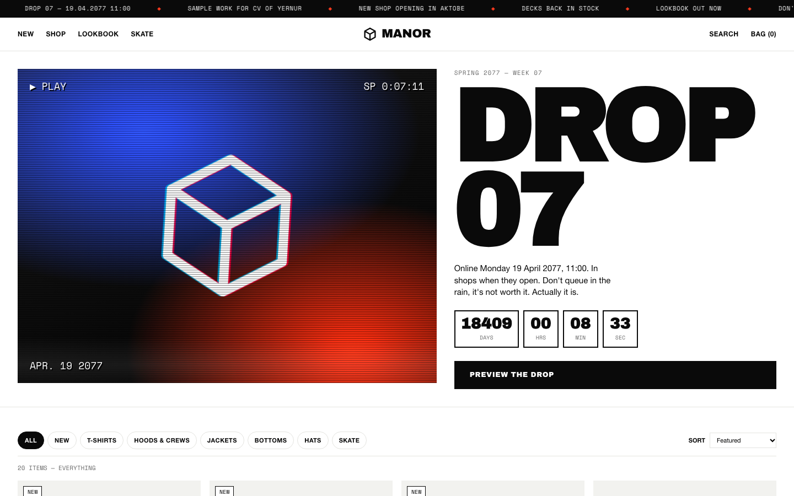
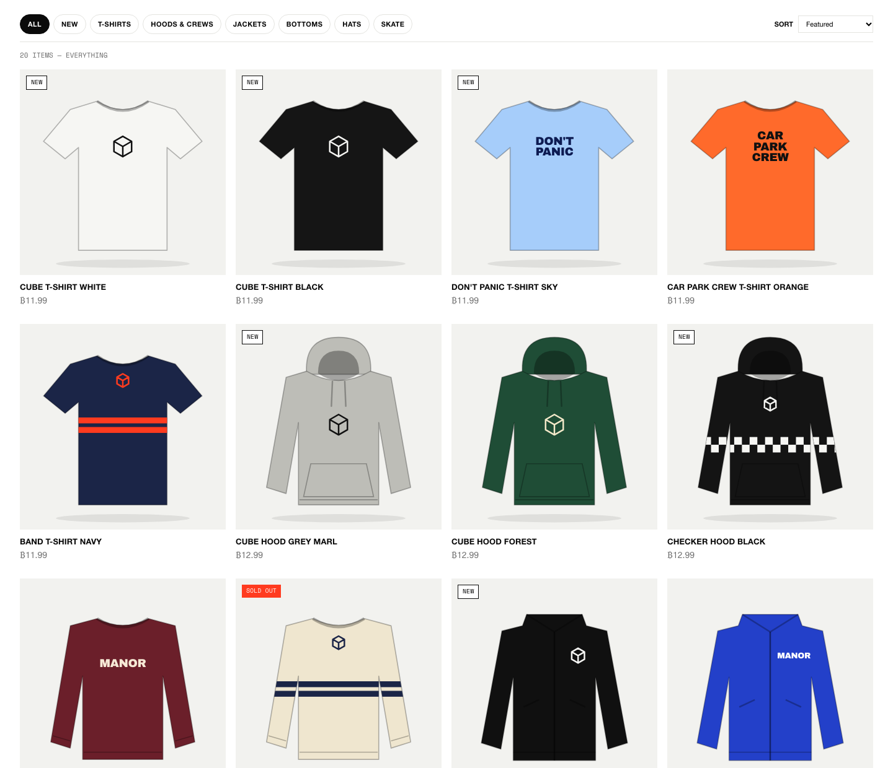
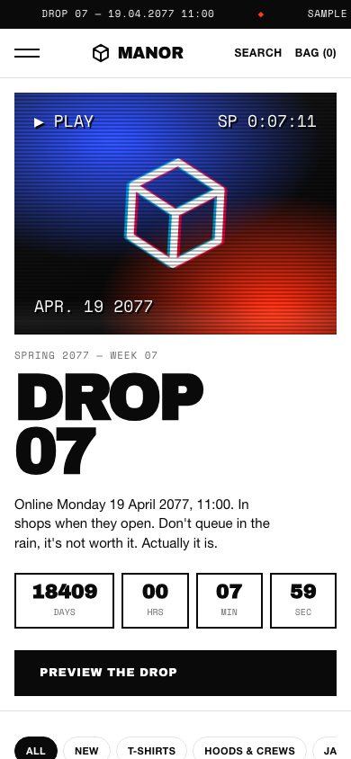
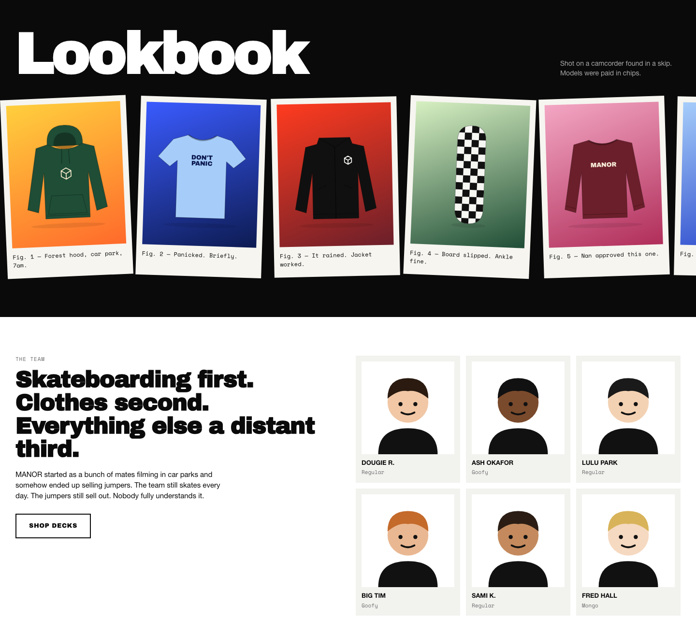

<div align="center">

# MANOR

**A streetwear & skateboard web shop, built from scratch with plain HTML, CSS and JavaScript.**

No frameworks · No build step · No image files · ~1,500 lines

[Features](#features) · [Run it locally](#run-it-locally) · [How it works](#how-it-works)

<br/>



</div>

---

## About

MANOR is a fictional skate brand with a full shopping front end: weekly drops, a filterable product catalogue, a quick-view pop-up, a shopping bag and a checkout flow.

The visual direction is inspired by London skate and streetwear labels: a stark white grid, heavy grotesque type, a scrolling news ticker, VHS-era video textures and dry, self-aware copywriting.

I built it as a portfolio piece to show front-end layout, interaction design and state management **without relying on any library**.

> **Note:** this is a sample project for my CV. The brand, products and team are made up, and no payments are taken.

---

## Features

| | |
|---|---|
| 🛍️ **Product catalogue** | 20 products across 6 categories, with category filters, a "New this week" view and sorting by price or name |
| 🔍 **Quick view** | A pop-up per product with front and back views, size picker, sold-out sizes and product details |
| 👜 **Shopping bag** | Slide-in drawer with quantity controls, a 3-per-person limit, a free-shipping progress bar, and contents that survive a page reload (`localStorage`) |
| 💳 **Checkout** | Address form with delivery options and a live order summary that ends in an order confirmation (demo only) |
| ⏱️ **Drop countdown** | Live countdown to the next release, inside an animated VHS-style banner |
| 🔎 **Search** | Full-screen search overlay with instant results |
| 📸 **Lookbook** | Horizontally scrolling, snap-aligned "polaroid" gallery; each photo opens its product |
| 📱 **Responsive** | Works from wide desktop down to small phones, with a slide-out mobile menu |
| ♿ **Accessible touches** | Keyboard-openable cards, `Esc` to close any layer, ARIA labels on dialogs, and respect for `prefers-reduced-motion` |

---

## Screenshots

<table>
  <tr>
    <td width="70%"></td>
    <td width="30%"></td>
  </tr>
  <tr>
    <td align="center"><sub>Product grid: hover a card to see the back of the garment</sub></td>
    <td align="center"><sub>Mobile layout</sub></td>
  </tr>
</table>


<p align="center"><sub>Lookbook gallery and team section</sub></p>

---

## How it works

### Every product image is drawn in code

The site doesn't ship a single image file. Each garment (T-shirt, hoodie, sweatshirt, jacket, trousers, cap, beanie, skateboard deck) is an **SVG template generated in JavaScript**, then filled with the product's colour and print:

```js
{ id: "cube-hood-forest", name: "Cube Hood Forest", cat: "hoods", type: "hood",
  color: "#1f4d36", ink: "#f2e8c9", price: 12.99, print: { kind: "cube" } }
```

- `type` picks the garment shape. Each shape defines its outline, seams and details, plus where prints sit on the front and back.
- `print` picks the artwork: the cube logo, a word, a stacked slogan, stripes or a checkerboard. Stripe and checker patterns are clipped to the garment's outline with `<clipPath>`.
- Every product also gets a back view, which the card cross-fades to on hover.

Adding a new product takes **one line of data**.

### State

All shop state (current filter, sort order, bag contents, the open product) lives in one small `state` object. Every change goes through a render function that redraws the affected part of the page. The bag is saved to `localStorage`, wrapped in `try/catch` so the shop still works in private browsing.

### Styling

- Design tokens (colours, fonts, spacing) are CSS custom properties on `:root`.
- Layout uses CSS Grid, with responsive changes at 1024px, 820px and 640px.
- The VHS banner is made entirely of CSS: layered gradients, a scan-line overlay, a rolling tracking band and an occasional colour glitch.

---

## Tech stack


- **HTML5**: semantic page structure and dialogs
- **CSS3**: Grid, custom properties, keyframe animations, sticky positioning, scroll snapping
- **Vanilla JavaScript (ES2020+)**: rendering, state, events and SVG generation
- **Google Fonts**: Archivo Black and Space Mono

---

## Run it locally

Serve it locally, for example with the **Live Server** extension in VS Code, or:

```bash
python3 -m http.server 8000   # then visit http://localhost:8000
```

---

## Project structure

```
manor/
├── index.html      # Page layout: header, hero, shop, lookbook, team, footer, pop-ups
├── styles.css      # Design tokens, layout, components, animations, responsive rules
├── app.js          # Product data, SVG garment drawing, filters, bag, checkout, search
└── screenshots/    # Images used in this README
```

---

## Customising

| To change… | Edit |
|---|---|
| Products, prices, colours | The `PRODUCTS` array in `app.js` |
| Drop date | `DROP_DATE` in `app.js` |
| Currency symbol | `CURRENCY` in `app.js` |
| Free-shipping threshold | `FREE_SHIP` in `app.js` |
| Ticker messages | The `TICKER` array in `app.js` |
| Colours and fonts | The CSS variables in `:root` in `styles.css` |

---

## Author

**Yernur**

- GitHub: [@Yernur007](https://github.com/Yernur007)
- LinkedIn: [Yernur](https://www.linkedin.com/in/yernur-n)

<sub>MANOR is a fictional brand created for this portfolio project. It is not affiliated with any real company.</sub>
